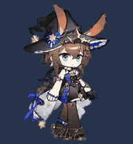
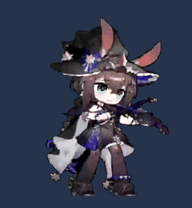
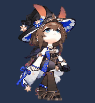
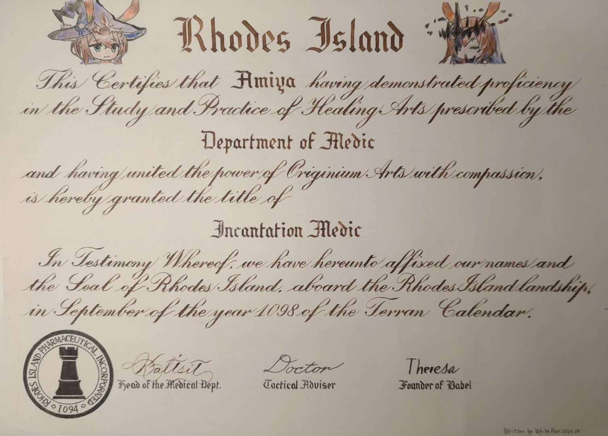

# 阿米娅 · 寰宇独奏 — Codex Pet

**把阿米娅带到你的 Codex 桌面。由用户提供创意与角色参考，OpenAI Codex 完成动画制作、验证、安装与发布工程。**

这是一份已经制作好的 **Codex v2 自定义宠物**。下载后即可安装，无须运行图像生成、配置 API Key 或安装 Python / Node.js。

[下载 v1.1.0 完整安装包](https://github.com/White-Pan/amiya-universe-solo-codex-pet/releases/download/v1.1.0/amiya-universe-solo-v1.1.0.zip) · [查看所有版本](https://github.com/White-Pan/amiya-universe-solo-codex-pet/releases)

| 待机 | 工作中 | 16 方向注视 |
| :---: | :---: | :---: |
|  |  |  |

## v1.1.0 更新

工作中动作改为演奏动画：从用户提供的视频中选取 6 个关键姿势，处理透明背景并适配 `running` 的 6 帧规范。其余动作和 16 方向注视保持不变，已验证图集并通过独立视觉复核。视频抽帧的细节与原生成动画略有区别，循环交界处披风变化稍明显。

保留原思考动作的 [v1.0.2 安装包](https://github.com/White-Pan/amiya-universe-solo-codex-pet/releases/tag/v1.0.2) 仍可下载。

## 下载与安装

需要支持 **v2 自定义宠物**的 Codex 桌面应用。此仓库是宠物资源包，不包含 Codex 应用本身。

1. 在仓库页面选择 **Code → Download ZIP**，或下载 **Releases** 中的完整安装包。
2. **完整解压**到任意目录。不要在压缩包内部直接运行脚本，也不要只下载 `pet.json`。
3. 按你的系统安装：

### Windows

双击 **`install.cmd`**，或在解压目录打开 PowerShell：

```powershell
powershell.exe -NoProfile -ExecutionPolicy Bypass -File .\install.ps1
```

**请复制上面的完整命令，不要直接运行 `./install.ps1` 或 `.\install.ps1`**：系统签名策略可能提示“未进行数字签名 / 无法加载文件”。也可以双击 `install.cmd`，它已包含相同启动参数。

`ExecutionPolicy Bypass` 仅用于该次 PowerShell 进程，不修改系统执行策略。安装无需管理员权限，不会联网下载依赖。

若旧版安装提示 `ConvertFrom-Json` 并出现中文乱码，请下载 v1.0.1 或更新版本并重新解压。这是旧安装脚本的编码读取问题，已修复。

### macOS / Linux

```sh
sh install.sh
```

需要系统提供 `shasum` 或 `sha256sum`。脚本可复制资源，但实际使用仍取决于你的系统是否有支持该格式的 Codex 桌面应用。Windows 安装已在隔离目录中测试；未在原生 macOS / Linux 上实测。

### 手动安装

将 `pet/` 内的两个文件放到以下位置：

```text
~/.codex/pets/amiya-universe-solo/
├── pet.json
└── spritesheet.webp
```

Windows 默认对应 `%USERPROFILE%\.codex\pets\amiya-universe-solo\`。如果你设置了 `CODEX_HOME`，请使用 `$CODEX_HOME/pets/amiya-universe-solo/`；两个安装脚本都会优先遵循该环境变量。

安装后打开 Codex 的宠物选择界面，选择 **阿米娅·寰宇独奏**。如果暂未显示，完全退出并重新打开 Codex。不同应用版本的入口名称可能不同。本项目不修改应用设置，也不会自动切换你当前的宠物。

### 更新与卸载

重复安装相同文件不会创建多余备份。如果检测到不同版本，脚本默认停止；显式更新会先备份原来的两个文件：

```powershell
powershell.exe -NoProfile -ExecutionPolicy Bypass -File .\install.ps1 -Update
```

```sh
sh install.sh --update
```

备份位于该宠物目录下的 `backups/`。卸载时只需移走或删除 `amiya-universe-solo` 目录，不要删除整个 `pets` 目录。

## 离线预览

双击 **`preview.html`**，可切换全部 9 组动作，并开启“随鼠标注视”查看 16 个方向。预览不需要启动服务器、不连接网络，也不读取你的 Codex 配置。GitHub 文件页显示的是 HTML 源码，请下载解压后打开。

## 动画与规格

| 状态 | 内容 | 帧数 |
| --- | --- | ---: |
| `idle` | 待机、呼吸与眨眼 | 6 |
| `running-right` | 向右移动 | 8 |
| `running-left` | 向左移动 | 8 |
| `waving` | 挥手 | 4 |
| `jumping` | 蓄力、跳起与落地 | 5 |
| `failed` | 失落反应 | 8 |
| `waiting` | 等待回应或批准 | 6 |
| `running` | 拉奏乐器、闭眼与身体摆动，非移动 | 6 |
| `review` | 查看结果 | 6 |
| 注视 | 顺时针 16 方向 | 16 |

- 格式：透明 WebP，`spriteVersionNumber: 2`。
- 图集：**1536 × 2288**；8 列 × 11 行；每格 **192 × 208**。
- 主方向：000° 向上、090° 向右、180° 向下、270° 向左。
- 已通过最终格式、尺寸、透明边缘检查及三份独立盲测的主方向判定。
- 已知小差异：067.5° / 292.5° 的抬头幅度较轻，两半圈交界处帽子轮廓变化略明显，跳跃时帽子看起来稍大。这些已经视觉复核并保留，不代表全套动作逐像素一致。

## 角色与来源

这是基于《明日方舟》阿米娅「寰宇独奏」形象制作的**非官方同人宠物**，不代表角色权利方或 OpenAI 官方发布。角色、名称、服装及原始美术的相关权利归各自权利人。本仓库公开可下载，不代表对第三方角色素材授予商业使用许可；详情见 [NOTICE.md](NOTICE.md)。

## 其他

1. 本项目大量信息与原美术素材来源于[https://prts.wiki/w/%E9%A6%96%E9%A1%B5 ](https://prts.wiki/w/%E9%A6%96%E9%A1%B5)在此感谢
2. 没有GPT-6 Astra，本项目无法完成

## At the End



（本人亲自书写，仅供娱乐）

以上内容

All Rights **Not** Reserved.

2026.10
